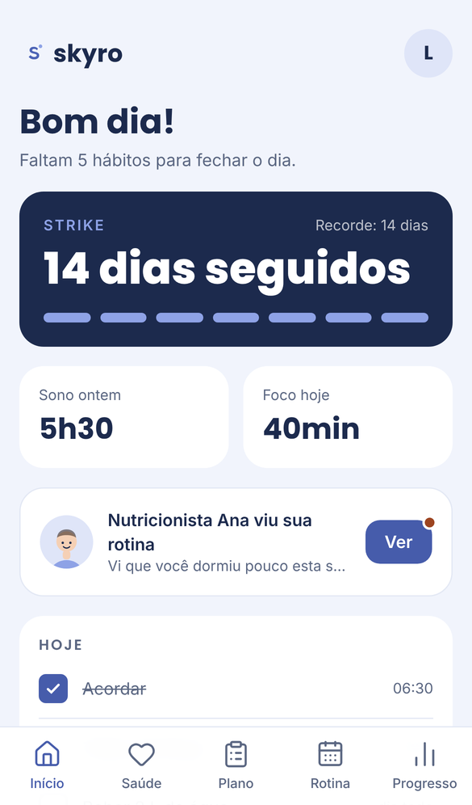
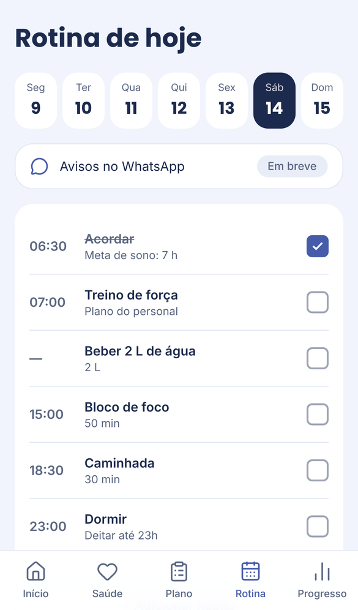
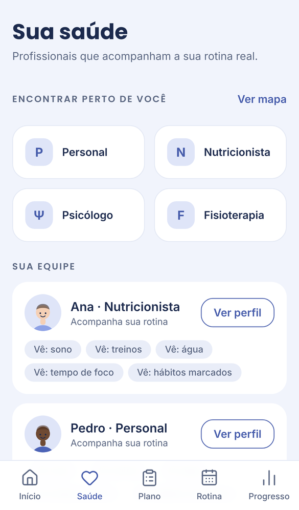
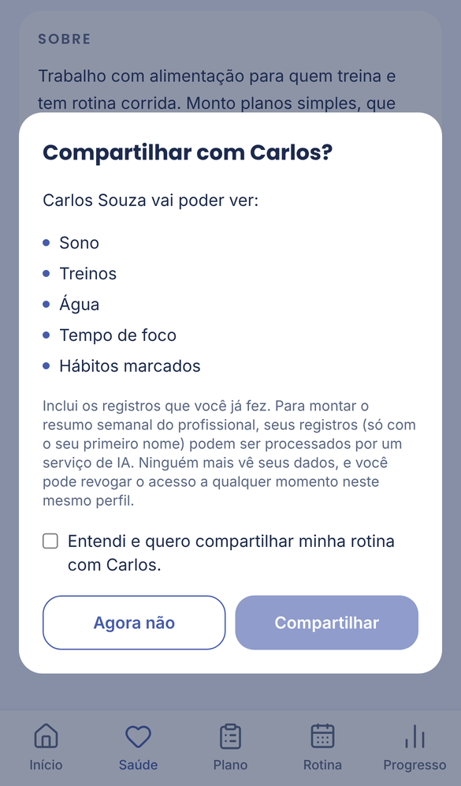
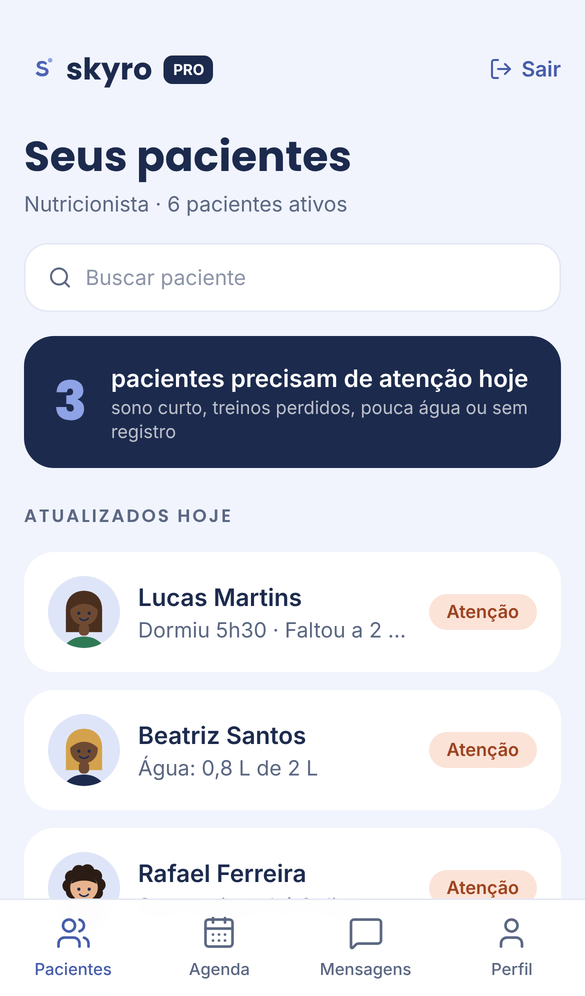
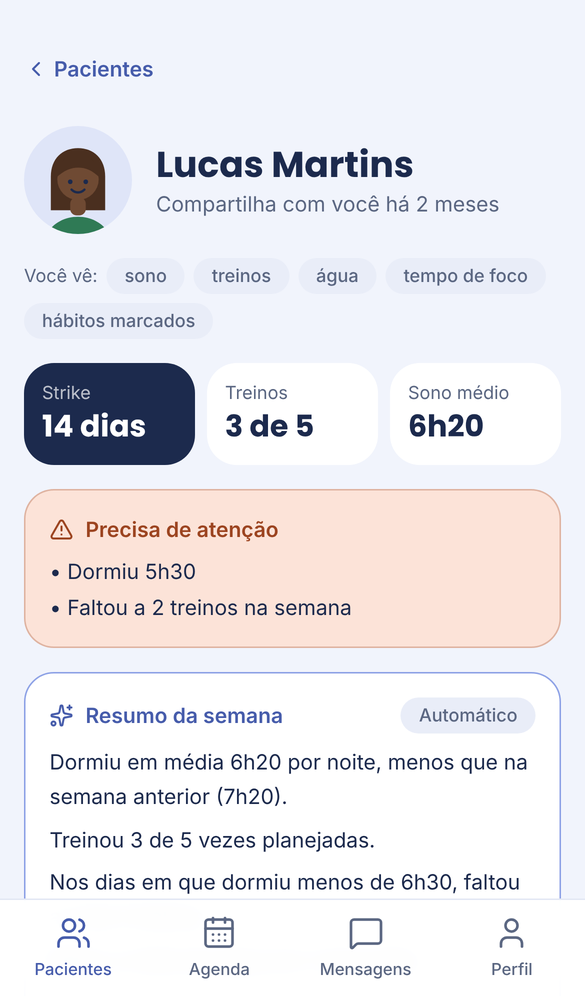
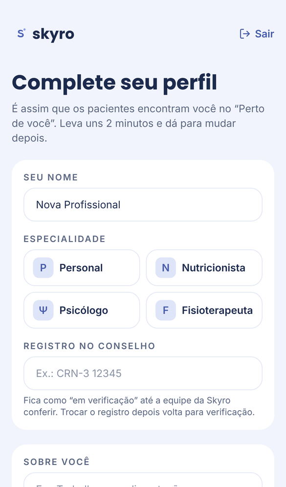
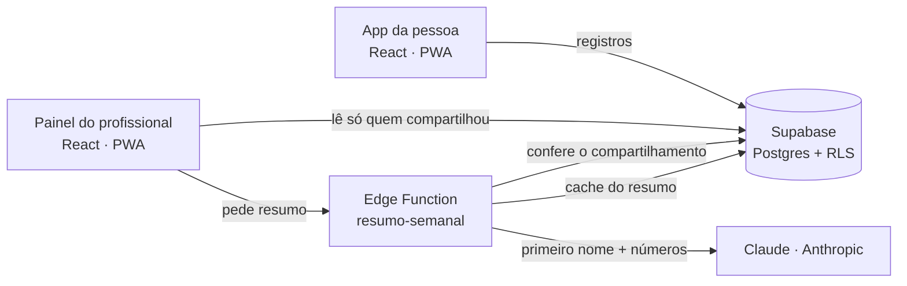

# Skyro

**Sua rotina, seus dados, todos os seus profissionais vendo o mesmo quadro.**


Projeto do **Hack Brasil 2026**, trilha 04 (Saúde & bem-estar).

> **Demo:** _link da Vercel aqui_ · **Vídeo:** _link do vídeo aqui_ · **Pitch:** [`docs/Skyro-Pitch-v2.pdf`](docs/Skyro-Pitch-v2.pdf)
>
> Para testar sem cadastro, use os botões **"Entrar como pessoa (demo)"**, **"Entrar como profissional (demo)"** e **"Entrar como equipe (demo)"** na tela de login.

---

## O problema

Quem começa a cuidar da saúde com um profissional só o encontra de tempos em tempos. **Entre uma consulta e outra, o profissional não sabe se a pessoa dormiu mal, faltou ao treino ou parou de beber água**, e ela perde o ritmo sem ninguém perceber.

Quando há mais de um profissional, piora: o nutricionista não sabe que a pessoa dormiu 5 horas, e o personal vê a falta no treino, mas não sabe por quê. **Cada um vê só um pedaço**, cada um no seu app.

## A solução

A Skyro é a **ponte entre a rotina que a pessoa registra no dia a dia e os profissionais que cuidam dela**.

1. **A pessoa registra a rotina:** sono, água, foco, treino e hábitos, com strike para manter o ritmo.
2. **Ela escolhe com quem compartilhar:** encontra profissionais perto dela, **dá consentimento explícito e pode revogar a qualquer momento**.
3. **O profissional vê quem precisa de atenção hoje** e lê um resumo da semana escrito por IA.
4. **Ele age antes da próxima consulta:** manda uma dica, que aparece no app da pessoa.

## Como funciona

### Para a pessoa

| Início | Rotina | Sua equipe | Compartilhar |
|---|---|---|---|
|  |  |  |  |
| Strike, sono, foco e checklist do dia | Hábitos e registro de sono, água, foco e treino | Os profissionais que acompanham a rotina | Consentimento explícito, por profissional |

**Meu plano:** tudo o que a equipe preparou, em quatro abas (Treino, Nutrição, Mente e Fisio). A pessoa marca o que fez no dia e, na fisioterapia, registra a dor de 0 a 10.

### Para o profissional

| Pacientes | Ficha do paciente | Dica para a pessoa | Cadastro |
|---|---|---|---|
|  |  |  |  |
| Quem precisa de atenção aparece primeiro, com o motivo | Semana, alertas e o resumo que cruza sono e treino | A dica chega no Início da pessoa | Perfil com local no mapa e registro do conselho |

**Plano na ficha do paciente:** cada profissional monta a parte dele (treino, plano alimentar, respiração ou exercícios de fisio), com os dias da semana, e vê quanto foi feito nos últimos 7 dias.

## O que nos diferencia

Já existem apps em que um profissional acompanha o paciente (Dietbox na nutrição, MFIT no treino) e vitrines para encontrar profissionais (Doctoralia). **O que não encontramos foi um lugar em que vários profissionais enxergam a mesma rotina, com os dados pertencendo à pessoa.**

| | Rotina diária | Profissional acompanha | Vários profissionais | Dados da pessoa | IA entre áreas |
|---|:-:|:-:|:-:|:-:|:-:|
| Apps de uma especialidade (Dietbox, MFIT) | Uma área | ✓ | | | |
| Busca de profissionais (Doctoralia) | | | Busca | | |
| Apps de hábitos | ✓ | | | ✓ | |
| **Skyro** | **✓** | **✓** | **✓** | **✓** | **✓** |

_Pesquisa rápida da equipe, sem acesso aos apps por dentro. Detalhes em [`docs/Skyro-Analise-de-Mercado.pdf`](docs/Skyro-Analise-de-Mercado.pdf)._

## IA com responsabilidade

- **A IA não decide quem precisa de atenção.** Isso é feito por **regras fixas e explicáveis**:
  - dormiu menos de 6 horas;
  - faltou a 2 ou mais treinos na semana;
  - bebeu menos de 50% da meta de água;
  - ficou 2 dias sem registrar.
- **A IA só escreve o resumo da semana para o profissional**, cruzando as áreas: "nos dias com menos de 6h de sono, faltou aos treinos".
- **Não diagnostica, não prescreve e não fala com o paciente.** Quem decide é o profissional.
- **Envia o mínimo:** só o primeiro nome e os números dos registros. A chave da IA fica no servidor, nunca no celular.
- **Sem IA, o app funciona igual:** se ela estiver desligada ou falhar, aparece um resumo montado pelas regras.

## Privacidade (LGPD)

- **Consentimento explícito e por profissional**, com a lista do que ele vai ver. A pessoa **revoga quando quiser**, e o acesso cai na hora.
- **Garantido pelo banco, não só pela tela:** o profissional não consegue ler a rotina de quem não compartilhou com ele.
- **Ninguém se dá selo de "verificado":** o registro do conselho fica "em verificação" até a equipe Skyro conferir na consulta do conselho e aprovar. Se recusar, o profissional vê o motivo e sai da busca até corrigir. Cada decisão fica registrada (quem, quando e o quê).
- **Foto só se a pessoa quiser:** o padrão é um avatar ilustrado, gerado no próprio app. Quem envia uma foto tem a imagem recortada e reduzida no próprio aparelho antes do envio. As contas e os perfis da demo usam só ilustrações.
- **Telefone sempre privado:** fica numa tabela que só a própria conta lê. Nem o profissional que acompanha a pessoa enxerga.

## Arquitetura



| Camada | Tecnologia |
|---|---|
| App (pessoa e profissional) | React 19, TypeScript, Vite, Tailwind CSS, PWA instalável |
| Banco, login e regras de acesso | Supabase: Postgres, Auth e Row Level Security |
| Mapa e endereços | OpenStreetMap, Leaflet e Nominatim |
| IA | Claude (Anthropic) numa Supabase Edge Function |
| Publicação | Vercel |

## Qualidade

- **56 testes automáticos** cobrem as regras de alerta, o strike, as datas, o resumo, o formulário e o prompt da IA.
- **Regras de acesso do banco** testadas: quem pode ver, gravar e revogar o quê.
- **Acessibilidade WCAG 2.1 AA:** as 13 telas passam na auditoria automática, com contraste, rótulos e áreas de toque de 44 px.
- **Testado em 5 tamanhos de tela**, do iPhone SE ao iPad.

## Rodar localmente

```bash
npm install
```

```bash
cp .env.example .env
```

Preencha o `.env` com a URL e a publishable key do Supabase, rode as migrations e os seeds no SQL Editor e então:

```bash
npm run dev
```

Passo a passo completo: [`docs/SETUP-MAC.md`](docs/SETUP-MAC.md). Guia técnico: [`docs/DESENVOLVIMENTO.md`](docs/DESENVOLVIMENTO.md).

## Próximos passos

- **Validar com pessoas e profissionais reais:** entrevistas e preço da assinatura para profissionais.
- **Avisos pelo WhatsApp**, treino em grupo, recompensas e integração com relógios.
- **Mais especialidades** com o mesmo quadro compartilhado.

## Modelo de negócio (a validar)

- **Pessoa:** gratuito para registrar a rotina e compartilhar; Premium com recursos extras.
- **Profissional:** assinatura do painel, com alertas e resumos por IA.
- **Parcerias:** academias e clínicas, sempre identificadas como serviço.

_Valores e preços serão testados com os profissionais entrevistados._

## Equipe

_Nomes e papéis da equipe aqui._

---

Versão de demonstração: perfis, avaliações e registros são fictícios. **A Skyro não substitui atendimento profissional e não faz diagnóstico.**
